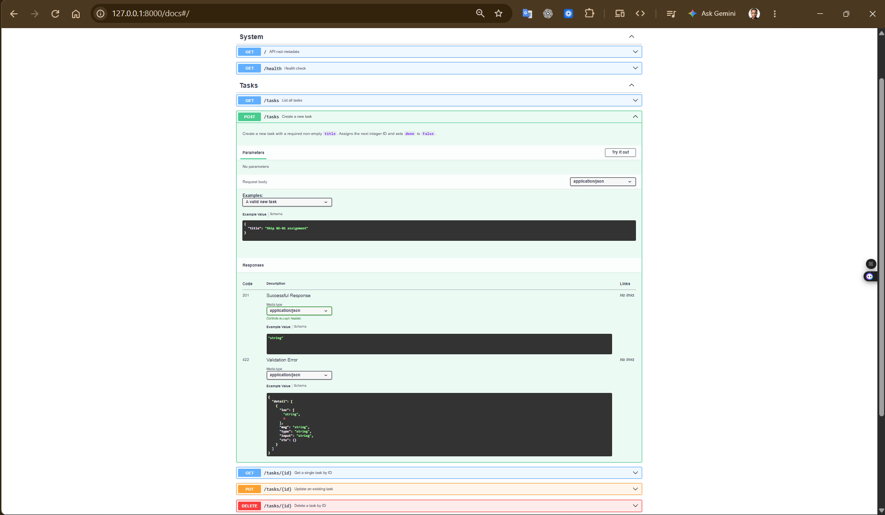

# BE-01: Build Your First CRUD API (Python + FastAPI)

A clean, zero-database RESTful CRUD API for managing tasks in memory, built incrementally with **Python** and **FastAPI** as part of the FlyRank Backend AI Engineering track.

---

## Quick Start (1-Command Run)

```bash
uvicorn main:app --reload --port 8000
```

> Need to set up the virtual environment first?
> ```bash
> python3 -m venv .venv && source .venv/bin/activate && pip install -r requirements.txt
> uvicorn main:app --reload --port 8000
> ```

Once running:
- **API Root**: `http://localhost:8000/`
- **Interactive Swagger UI**: `http://localhost:8000/docs`

---

## Endpoints Reference

| Method | Path | Status Codes | Description |
| :--- | :--- | :--- | :--- |
| `GET` | `/` | `200 OK` | Returns API metadata (`name`, `version`, and available `endpoints`). |
| `GET` | `/health` | `200 OK` | Health check endpoint returning `{"status": "ok"}`. |
| `GET` | `/tasks` | `200 OK` | Lists all tasks. Supports optional `?done=true\|false`, `?search=keyword`, and `?limit=&offset=` query parameters. |
| `GET` | `/tasks/{id}` | `200 OK`, `404 Not Found` | Retrieves a single task by integer `id`, or `{"error": "Task {id} not found"}` if missing. |
| `POST` | `/tasks` | `201 Created`, `400 Bad Request` | Creates a new task from `{"title": "..."}` with `done: false` and the next integer `id`. |
| `PUT` | `/tasks/{id}` | `200 OK`, `400 Bad Request`, `404 Not Found` | Updates an existing task's `title` and/or `done` status by integer `id`. |
| `DELETE` | `/tasks/{id}` | `204 No Content`, `404 Not Found` | Deletes a task by integer `id` and returns an empty response body on success. |
| `GET` | `/stats` | `200 OK` | Returns task count statistics: `{"total": X, "done": Y, "open": Z}`. |
| `POST` | `/reset` | `200 OK` | Restores the in-memory `tasks` list back to the original 3 starter tasks. |

---

## Real `curl -i` Checkpoint Output

Below is the actual terminal output captured during our Stage 4 full CRUD verification (`POST` -> `PUT` -> `GET` -> `DELETE` -> `GET`):

```http
$ curl -i -X POST http://localhost:8000/tasks -H "Content-Type: application/json" -d '{"title": "Deploy FastAPI service"}'
HTTP/1.1 201 Created
date: Mon, 19 Oct 2026 11:38:07 GMT
server: uvicorn
content-length: 54
content-type: application/json

{"id":4,"title":"Deploy FastAPI service","done":false}

$ curl -i -X PUT http://localhost:8000/tasks/4 -H "Content-Type: application/json" -d '{"title": "Deploy FastAPI service to prod", "done": true}'
HTTP/1.1 200 OK
date: Mon, 19 Oct 2026 11:38:07 GMT
server: uvicorn
content-length: 61
content-type: application/json

{"id":4,"title":"Deploy FastAPI service to prod","done":true}

$ curl -i http://localhost:8000/tasks/4
HTTP/1.1 200 OK
date: Mon, 19 Oct 2026 11:38:07 GMT
server: uvicorn
content-length: 61
content-type: application/json

{"id":4,"title":"Deploy FastAPI service to prod","done":true}

$ curl -i -X DELETE http://localhost:8000/tasks/4
HTTP/1.1 204 No Content
date: Mon, 19 Oct 2026 11:38:07 GMT
server: uvicorn


$ curl -i http://localhost:8000/tasks/4
HTTP/1.1 404 Not Found
date: Mon, 19 Oct 2026 11:38:07 GMT
server: uvicorn
content-length: 28
content-type: application/json

{"error":"Task 4 not found"}
```

---

## Swagger UI (`/docs`) Screenshot



*(Save your screenshot of `http://localhost:8000/docs` to `./assets/swagger-ui.png`)*

---

## The Mortality Experiment

When the FastAPI server restarts or reloads, every newly created, updated, or deleted task vanishes and the API reverts to the 3 hardcoded starter tasks. This happens because `tasks` is stored as a Python list in volatile process RAM rather than persisted to a durable disk-backed database or file, so terminating the process immediately frees that memory.

---

## AI vs Me

### The Prompt Used
> *"Build a single-file FastAPI Task CRUD API on port 8000 with in-memory storage (3 starter tasks with id, title, done). Include GET /, GET /health, GET /tasks (with done, search, limit, offset query params), GET /tasks/{id}, POST /tasks (201), PUT /tasks/{id} (200), DELETE /tasks/{id} (204), GET /stats, and POST /reset. All 400 and 404 errors must return JSON in the exact format `{"error": "..."}` instead of FastAPI's default `{"detail": "..."}`."*

### 3 Concrete Differences Found via `git diff` (`git diff --no-index main.py ai-version/main_ai.py`)

1. **Validation & Error Shaping (`JSONResponse` vs. Pydantic + `@app.exception_handler`)**:
   - **My version (`main.py`)**: Inspects the raw dictionary `payload` inside `create_task` and `update_task` and directly returns `JSONResponse(status_code=400, content={"error": ...})`, giving each route fine-grained, explicit control over its exact 400 error message (`"Title is required and cannot be empty"`, `"Title cannot be empty"`, `"'done' must be a boolean"`).
   - **AI version (`ai-version/main_ai.py`)**: Uses Pydantic `BaseModel` classes (`TaskCreate`, `TaskUpdate`) with `@field_validator` decorators and overrides FastAPI's global `RequestValidationError` (422) and `HTTPException` handlers. A side effect of the AI's global `RequestValidationError` handler is that *any* schema validation error—even on `PUT /tasks/{id}` or query parameters—gets flattened into `"Title is required and cannot be empty"`.
2. **Route Documentation & OpenAPI Polish**:
   - **My version (`main.py`)**: Includes `summary`, `tags`, `openapi_examples`, query parameter `description`s, and docstrings on every endpoint so `/docs` is immediately self-documenting.
   - **AI version (`ai-version/main_ai.py`)**: Omitted route docstrings, summaries, and OpenAPI parameter descriptions in favor of compact function bodies.
3. **Collection Lookup & Slicing Style**:
   - **My version (`main.py`)**: Uses step-by-step `for` loops and explicit `if done is not None:` / `if search is not None:` filter blocks that are easy to step through in a debugger.
   - **AI version (`ai-version/main_ai.py`)**: Condenses lookup and filtering into single-line generator expressions (`next((t for t in tasks if t["id"] == id), None)`) and compound list comprehensions with slice arithmetic (`filtered[offset : offset + limit if limit is not None else None]`).

### What Changed on Rematch
Comparing the two versions side-by-side highlighted why understanding request lifecycle fundamentals matters: while the AI's Pydantic + custom exception handler approach looks idiomatic at first glance, its blanket `RequestValidationError` handler accidentally masks specific `PUT` validation errors and query-param type errors under a single hardcoded message, whereas our hand-built stage-by-stage validation handles each error case accurately without side effects.
