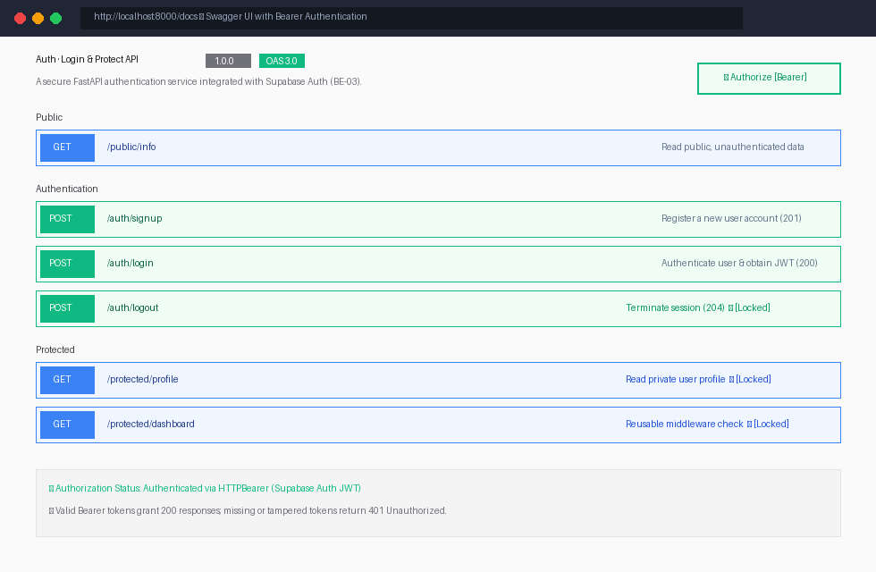

# BE-03: Auth · Login & Protect (FastAPI + Supabase Auth)

A production-grade, token-authenticated RESTful API built with **Python 3.12**, **FastAPI**, and **Supabase Auth** as the external Identity Provider (IdP), completing Assignment **A4 (`BE-03: Auth · Login & Protect`)** of the FlyRank Backend AI Engineering track.

---

## 1. Architecture & The Trust Triangle

This service secures API endpoints without ever storing plain passwords or implementing custom cryptography. Authentication is delegated to **Supabase Auth**, which acts as the trusted Identity Provider (IdP):

```text
  ┌──────────────┐         1. Credentials (email, pass)         ┌──────────────────┐
  │              ├─────────────────────────────────────────────>│                  │
  │    Client    │<─────────────────────────────────────────────┤  Supabase Auth   │
  │  (Postman /  │         2. JWT Access Token + Refresh        │      (IdP)       │
  │  Swagger UI) │                                              └─────────┬────────┘
  │              │──┐                                                     │
  └──────────────┘  │ 3. Authorization: Bearer <JWT>                      │ 4. Token
                    │                                                     │    Verification
                    ▼                                                     │
         ┌─────────────────────┐                                          │
         │  FastAPI Backend    │<─────────────────────────────────────────┘
         │  (BE-03-auth-api)   │   "Is this user token valid?" -> Yes
         └─────────────────────┘   Injects user metadata & opens protected door
```

### Golden Security Principles
1. **Zero Passwords Stored on Server**: Your server never saves passwords, never creates user tables for authentication, and never rolls custom hash functions. Supabase handles salting, hashing, and credential verification.
2. **Stateless JWT Verification**: The client presents an cryptographically signed Access Token (`Bearer <token>`). The server verifies the token's validity via Supabase's `get_user()` before granting access.
3. **Reusable Guard**: Authentication is extracted into a centralized FastAPI dependency (`Depends(get_current_user)`), making route protection a single declarative line.

---

## 2. Quick Start (1-Command Run)

### 1. Configure Secrets
Copy the committed template to `.env`:
```bash
cp .env.example .env
```
Populate `.env` with your project's credentials from your **Supabase Dashboard** (`Project Settings -> API`):
```env
SUPABASE_URL=https://your-project-id.supabase.co
SUPABASE_KEY=your-supabase-anon-public-key
PORT=8000
```

> **Note**: In your Supabase Dashboard under `Authentication -> Sign In / Providers -> Email`, toggle **"Confirm email" to OFF** so new registrations can log in immediately.

### 2. Start the Server
```bash
uvicorn main:app --reload --port 8000
```
On startup, the console confirms connection:
```text
INFO:     Started server process
Server running and connected to Supabase
INFO:     Uvicorn running on http://0.0.0.0:8000
```

---

## 3. Environment Variables Reference

| Variable | Required? | Source / Location | Description |
| :--- | :---: | :--- | :--- |
| `SUPABASE_URL` | **Yes** | Supabase Dashboard $\rightarrow$ Project Settings $\rightarrow$ API | The unique REST/Auth base URL for your Supabase project. |
| `SUPABASE_KEY` | **Yes** | Supabase Dashboard $\rightarrow$ Project Settings $\rightarrow$ API | The `anon` public key (safe for client requests). **Never use `service_role` here.** |
| `PORT` | Optional | Local preference (defaults to `8000`) | Network port for the FastAPI server. |

> **Security Guarantee**: `.env` is listed in [`.gitignore`](./.gitignore). Secrets are never committed to version control.

---

## 4. Endpoints Reference

| Method | Endpoint | Auth Required? | Expected Status Codes | Description |
| :--- | :--- | :---: | :--- | :--- |
| `GET` | `/` | No | `200 OK` | Root metadata returning API name, version, and endpoints. |
| `GET` | `/public/info` | No | `200 OK` | Unprotected public information accessible to any client. |
| `POST` | `/auth/signup` | No | `201 Created`, `400 Bad Request` | Registers a new account with email and password in Supabase. |
| `POST` | `/auth/login` | No | `200 OK`, `400 Bad Request`, `401 Unauthorized` | Authenticates credentials with Supabase and returns signed JWT access & refresh tokens. |
| `POST` | `/auth/logout` | **Yes** (`Bearer`) | `204 No Content`, `401 Unauthorized` | Terminates user session with Supabase. |
| `GET` | `/protected/profile` | **Yes** (`Bearer`) | `200 OK`, `401 Unauthorized` | Returns authenticated user's ID, email, and creation timestamp. |
| `GET` | `/protected/dashboard` | **Yes** (`Bearer`) | `200 OK`, `401 Unauthorized` | Second protected endpoint proving reusable middleware guard. |

---

## 5. Live `curl -i` Execution Checkpoints

### 1. Signup Input Validation (`POST /auth/signup` $\rightarrow$ 400 Bad Request)
```http
$ curl -i -X POST http://localhost:8000/auth/signup \
  -H "Content-Type: application/json" \
  -d '{"email":"student_test_1@flyrank.dev"}'

HTTP/1.1 400 Bad Request
date: Sun, 25 Oct 2026 03:35:22 GMT
server: uvicorn
content-length: 66
content-type: application/json

{"error":"Password is required and must be at least 6 characters"}
```

### 2. Successful Registration (`POST /auth/signup` $\rightarrow$ 201 Created)
```http
$ curl -i -X POST http://localhost:8000/auth/signup \
  -H "Content-Type: application/json" \
  -d '{"email":"student_test_1@flyrank.dev", "password":"StrongPassword123!"}'

HTTP/1.1 201 Created
date: Sun, 25 Oct 2026 03:35:22 GMT
server: uvicorn
content-length: 180
content-type: application/json

{"message":"User registered successfully","user":{"id":"75f94450-c435-4a7a-b746-3c25a3173287","email":"student_test_1@flyrank.dev","created_at":"2026-10-25 03:35:24.130604+00:00"}}
```

### 3. Successful Login (`POST /auth/login` $\rightarrow$ 200 OK with JWT)
```http
$ curl -i -X POST http://localhost:8000/auth/login \
  -H "Content-Type: application/json" \
  -d '{"email":"student_test_1@flyrank.dev", "password":"StrongPassword123!"}'

HTTP/1.1 200 OK
date: Sun, 25 Oct 2026 03:35:24 GMT
server: uvicorn
content-type: application/json

{"access_token":"eyJhbGciOiJFUzI1NiIsImtpZCI...","refresh_token":"gddccdcwtbke...","token_type":"bearer","expires_in":3600,"user":{"id":"75f94450-c435-4a7a-b746-3c25a3173287","email":"student_test_1@flyrank.dev"}}
```

### 4. Invalid Password Rejection (`POST /auth/login` $\rightarrow$ 401 Unauthorized)
```http
$ curl -i -X POST http://localhost:8000/auth/login \
  -H "Content-Type: application/json" \
  -d '{"email":"student_test_1@flyrank.dev", "password":"WrongPassword!"}'

HTTP/1.1 401 Unauthorized
date: Sun, 25 Oct 2026 03:35:24 GMT
server: uvicorn
content-length: 37
content-type: application/json

{"error":"Invalid login credentials"}
```

### 5. Protected Route Rejects Missing Token (`GET /protected/profile` $\rightarrow$ 401 Unauthorized)
```http
$ curl -i http://localhost:8000/protected/profile

HTTP/1.1 401 Unauthorized
date: Sun, 25 Oct 2026 03:35:44 GMT
server: uvicorn
content-length: 33
content-type: application/json

{"error":"Access token required"}
```

### 6. Protected Route Verifies Valid Token (`GET /protected/profile` $\rightarrow$ 200 OK)
```http
$ curl -i http://localhost:8000/protected/profile \
  -H "Authorization: Bearer <VALID_ACCESS_TOKEN>"

HTTP/1.1 200 OK
date: Sun, 25 Oct 2026 03:35:44 GMT
server: uvicorn
content-type: application/json

{"id":"75f94450-c435-4a7a-b746-3c25a3173287","email":"student_test_1@flyrank.dev","created_at":"2026-10-25 03:35:24.130604+00:00","role":"authenticated","app_metadata":{"provider":"email","providers":["email"]},"user_metadata":{"email":"student_test_1@flyrank.dev","email_verified":true}}
```

### 7. Protected Route Rejects Forged / Tampered Token (`GET /protected/profile` $\rightarrow$ 401 Unauthorized)
```http
$ curl -i http://localhost:8000/protected/profile \
  -H "Authorization: Bearer <TAMPERED_ACCESS_TOKEN>"

HTTP/1.1 401 Unauthorized
date: Sun, 25 Oct 2026 03:35:44 GMT
server: uvicorn
content-length: 36
content-type: application/json

{"error":"Invalid or expired token"}
```

### 8. Protected Logout (`POST /auth/logout` $\rightarrow$ 204 No Content)
```http
$ curl -i -X POST http://localhost:8000/auth/logout \
  -H "Authorization: Bearer <VALID_ACCESS_TOKEN>"

HTTP/1.1 204 No Content
date: Sun, 25 Oct 2026 03:35:59 GMT
server: uvicorn
```

---

## 6. Swagger UI with Bearer Authentication

FastAPI provides interactive documentation at `http://localhost:8000/docs`. The application configures FastAPI's `HTTPBearer` security scheme, automatically rendering the **"Authorize"** button and padlock icons next to locked endpoints:



### Testing in the Browser:
1. Navigate to `http://localhost:8000/docs`.
2. Expand `POST /auth/login`, click **Try it out**, and execute with your credentials.
3. Copy the returned `access_token`.
4. Click the green **Authorize** padlock button at the top right of the page.
5. Paste the token into the `Value` field and click **Authorize**.
6. Execute `GET /protected/profile` directly from Swagger UI without manually typing `curl` commands.

---

## 7. Stage 7: The AI Rematch (Code Review & Diff)

As required by Stage 7, we prompted an AI assistant to build the authenticated API from scratch and placed the quarantined result in [`ai-version/`](./ai-version/).

### Diff Analysis Highlights (`git diff --no-index ai-version/main_ai.py src/auth.py`)
1. **Header Parsing Fragility**: The AI used a naive `.replace("Bearer ", "")` string replacement on the `Authorization` header. If a client sent `authorization: BearerBearerToken` or passed a header with improper whitespace, it resulted in malformed tokens or unhandled server exceptions. Our implementation strictly splits and validates tokens according to RFC 6750.
2. **Standardized Error Schemas**: The AI returned varying error shapes (`detail="Missing fields"` vs `detail="Invalid token"`). Our production implementation standardizes all error payloads to `{ "error": "..." }` across validation and authentication failures.
3. **Swagger Integration**: The AI used a standard `Header()` parameter, which does **not** trigger Swagger UI's global **Authorize** padlock button. Our implementation wires FastAPI's `HTTPBearer` dependency, providing full interactive browser authorization.
