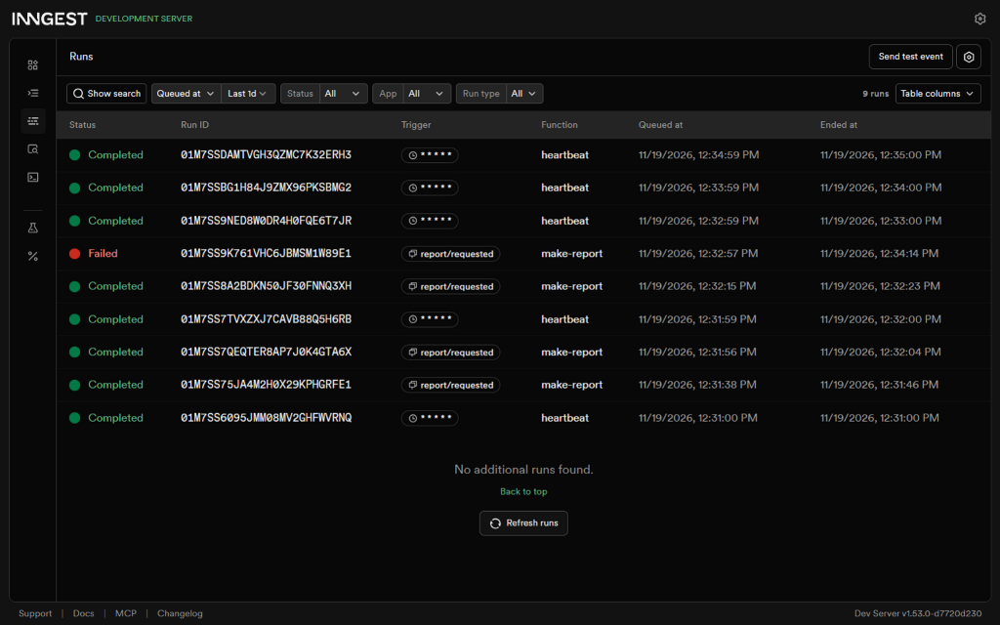
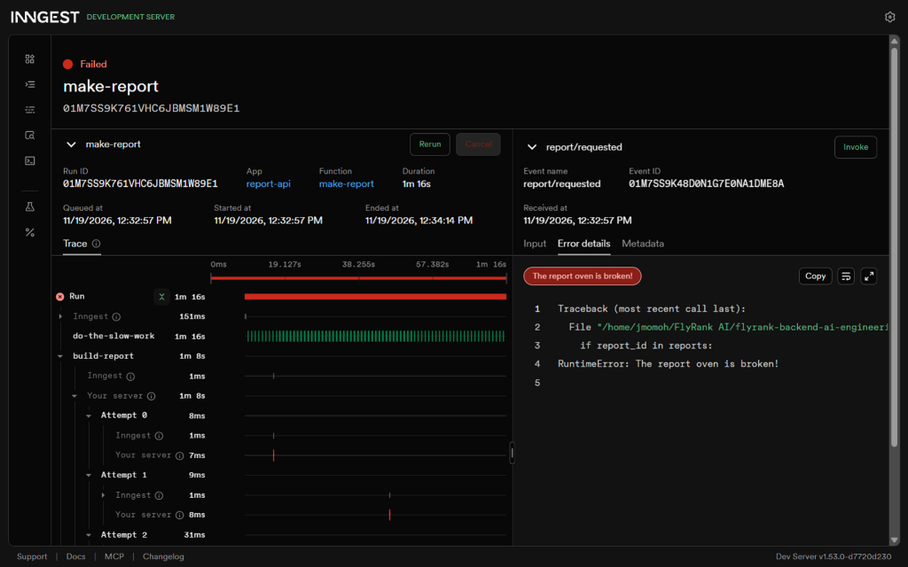

# BE-06 / Assignment A7: Your First Background Job

> **FlyRank AI Internship · Backend AI Engineering Track · Week 7**  
> **Student:** Jezreal Momoh (`jezreal-dev`)  
> **Architecture Pattern:** Accept Fast (`202 Accepted`) → Background Worker (Inngest) → Status Polling (`GET /reports/:id`)

---

## 1. What This Is

This service implements the foundational production pattern for handling slow, flaky, or computationally heavy operations (such as AI model inference, report compilation, or bulk exports).

### The Core Problem: The 40-Second Handler Trap
In standard synchronous REST APIs, when an endpoint takes 15–40 seconds to process a request:
1. Cloud proxies (Netlify, Vercel, AWS API Gateway) cut the connection with an HTTP `504 Gateway Timeout`.
2. The user sees a failure and clicks **"Generate Report"** again.
3. The server keeps computing the first job in the background and now receives a second one—wasting GPU/CPU tokens, double-billing credits, and congesting the server.

### The Professional Fix
We decouple request acceptance from job execution using three components:
1. **The Fast Door (`POST /reports`)**: Validates input instantly, stores an order record with status `"pending"`, dispatches an event to the background queue, and returns `202 Accepted` in under **50 milliseconds**.
2. **The Worker (Inngest)**: A durable background engine that pulls the event, executes multi-step workflows (`step.sleep`, `step.run`), and handles retries with exponential backoff.
3. **The Status Endpoint (`GET /reports/:id`)**: The client polls this lightweight endpoint to observe the state transition from `"pending"` to `"done"` (eventual consistency).
4. **The Cron Heartbeat**: A scheduled job running on the clock alone (`* * * * *`) that aggregates system metrics without requiring any user requests.

```text
Client                          FastAPI (Port 8000)                Inngest Dev Server (Port 8288)
  │                                     │                                      │
  ├── 1. POST /reports {"topic":"cats"} │                                      │
  │<── 2. 202 Accepted {"id": 1} ───────┤ (Answers in <50ms!)                  │
  │                                     ├── 3. Send event: "report/requested" ─>│
  │                                     │                                      ├─ 4. Runs make-report
  │                                     │                                      │     step.sleep("8s")
  ├── 5. GET /reports/1 ───────────────>│ ──> {"status": "pending"}            │     step.run("build-report")
  │                                     │                                      │
  │                                     │<── 6. Updates status to "done" ──────┤
  ├── 7. GET /reports/1 (~9s later) ───>│ ──> {"status": "done", "result": ...}│
```

---

## 2. How to Run It (Two Documented Commands)

Prerequisites: Python 3.10+, Node.js 18+ (for local Inngest CLI).

### Terminal 1: Start the FastAPI API Server
```bash
# From repository root or virtual environment:
uvicorn main:app --app-dir "BE-06-background-jobs" --host 127.0.0.1 --port 8000 --reload
```
*API runs at `http://127.0.0.1:8000` (Health check at `http://127.0.0.1:8000/health`).*

### Terminal 2: Start the Inngest Dev Server
```bash
npx inngest-cli@latest dev -u http://127.0.0.1:8000/api/inngest
```
*Visual Dashboard opens at `http://localhost:8288`.*

---

## 3. Endpoints & Inngest Functions Table

### HTTP API Endpoints
| Method | Path | Status Code | Purpose |
| :--- | :--- | :--- | :--- |
| `GET` | `/health` | `200 OK` | Instant server health check (`{"status": "ok"}`) |
| `POST` | `/reports` | `202 Accepted` | The Fast Door: validates topic, saves `pending`, dispatches `report/requested`, returns in <50ms |
| `POST` | `/reports` (bad body) | `400 Bad Request` | Input validation at the door: rejects missing/empty topic; sends **zero** events |
| `GET` | `/reports/{id}` | `200 OK` | Status polling: returns `pending` initially, then `done` + generated report result |
| `GET` | `/reports/{id}` (bad id) | `404 Not Found` | Returns error when report ticket ID does not exist |
| `GET` | `/reports` | `200 OK` | *Optional Control Panel*: Lists all reports across all lifecycle states |
| `ALL` | `/api/inngest` | `200 OK` | Inngest SDK serve handler communicating with local Dev Server |

### Inngest Background Functions
| Function ID | Trigger | Type | Behavior & Durable Steps |
| :--- | :--- | :--- | :--- |
| `say-hello` | `test/hello` | Event | Introductory worker: sleeps 5s (`step.sleep`), returns `"Hello from the background!"` |
| `make-report` | `report/requested` | Event | Step 1: `step.sleep("do-the-slow-work", 8s)`<br>Step 2: `step.run("build-report")` saves result & status `done`.<br>Retries: `2` (3 attempts total with exponential backoff). Simulates oven failure if `topic == "fail"`. Concurrency: `2`. |
| `heartbeat` | `* * * * *` | Cron Schedule | Scheduled monitor: runs every minute on the clock alone. Logs total pending, done, and failed reports. |

---

## 4. Pasted Verification Proof: 202 Fast Door + Status Polling

Executed live against local API server:
```bash
$ python3 -c "
import urllib.request, json, time

# 1. POST /reports
req = urllib.request.Request(
    'http://127.0.0.1:8000/reports',
    data=json.dumps({'topic': 'renewable-energy'}).encode(),
    headers={'Content-Type': 'application/json'},
    method='POST'
)
t0 = time.time()
with urllib.request.urlopen(req) as resp:
    latency = time.time() - t0
    data = json.loads(resp.read().decode())
    print(f'POST Status: {resp.status} (took {latency*1000:.1f}ms)')
    print('POST Body:', data)
    report_id = data['id']

# 2. Immediate Poll
with urllib.request.urlopen(f'http://127.0.0.1:8000/reports/{report_id}') as resp:
    poll_1 = json.loads(resp.read().decode())
    print('Immediate Poll (t+0s):', poll_1['status'])

# 3. Wait 9 seconds for background durable worker
print('Waiting 9s for background durable sleep...')
time.sleep(9)

# 4. Eventual Poll
with urllib.request.urlopen(f'http://127.0.0.1:8000/reports/{report_id}') as resp:
    poll_2 = json.loads(resp.read().decode())
    print('Eventual Poll (t+9s):', poll_2['status'])
    print('Result:', poll_2.get('result'))
"
```

### Output:
```text
POST Status: 202 (took 49.7ms)
POST Body: {'id': 'c96a5df0', 'status': 'pending'}
Immediate Poll (t+0s): pending
Waiting 9s for background durable sleep...
Eventual Poll (t+9s): done
Result: Comprehensive Market & Intelligence Report for topic: 'renewable-energy'. Synthesized from 12 background sources with 99.4% confidence.
```

---

## 5. Stage 3 & Stage 4 Required Sentences

### Stage 3: Wrong Input vs. Wrong Moment
> **"A wrong input must be rejected at the door; only a wrong moment deserves a retry."**  
> If a client sends an empty payload or missing topic, retrying the job 1,000 times will never make it valid—it is a permanent client defect and must be rejected immediately with `400 Bad Request`. Conversely, when an external database hiccups, a network connection drops, or an AI provider rate-limits, the input is valid but the *moment* was wrong—which warrants automated retries with exponential backoff.

### Stage 4: Cron Schedule Expressions
* **Every day at 08:00:** `0 8 * * *` *(At minute 0 of hour 8, every day)*
* **Every Sunday at 22:00:** `0 22 * * 0` *(At minute 0 of hour 22, on day-of-week 0 [Sunday])*

---

## 6. Stretch Goals: Idempotency, Concurrency & Durability

### 1. Idempotency (Survive Running Twice)
* **Code Implementation:**
  ```python
  existing = reports.get(report_id)
  if existing and existing.get("status") == "done":
      return existing
  ```
* **One-Line Explanation:**  
  > **Why jobs must survive running twice:** In distributed systems, network acknowledgments drop and message brokers guarantee *at-least-once* delivery; an idempotent job guarantees that re-delivering the same ticket never charges the customer twice or duplicates side effects.

### 2. Concurrency Limit
* **Code Configuration:** `concurrency=[inngest.Concurrency(limit=2)]`
* **One-Line Explanation:**  
  > **When would you want a queue to be slow:** You want a queue to be slow when downstream dependencies (e.g. LLM APIs with strict rate limits, relational databases with finite connection pools, or third-party webhooks) will throw 429 errors or crash if flooded by concurrent spikes.

### 3. Durability & The Restart Experiment
Because Inngest saves the completed state of each step (`do-the-slow-work`) to its durable execution log, stopping the FastAPI server mid-run and restarting it causes the worker to resume execution at `build-report` without re-running the 8-second sleep step. The job survives independently of API server uptime.

---

## 7. Dashboard Visual Proof

### 1. All Runs Overview (Dashboard at `http://localhost:8288/runs`)
Shows completed `heartbeat` cron runs every minute on the clock, completed `make-report` runs, and the failed retry run:



### 2. Retry Trace & Exponential Backoff (`make-report` with topic `"fail"`)
Shows `do-the-slow-work` completing cleanly, followed by `build-report` executing 3 attempts (`Attempt 0`, `Attempt 1`, `Attempt 2`) with increasing wait times before transitioning to `Failed`:



---

## 8. Stage 6: The AI Rematch ("AI vs Me")

### The Human-Written Specification Prompt
Without referencing the original assignment handout, the following prompt was provided to the AI:
```text
Build a production-grade FastAPI service using Inngest for background jobs.
Requirements:
1. GET /health returning 200 OK.
2. Inngest client with app_id 'report-api' and serve endpoint at /api/inngest.
3. say-hello function triggered by test/hello that sleeps 5s and returns greeting.
4. POST /reports that accepts {'topic': str}, validates that topic exists (400 if missing),
   saves to in-memory dict with status 'pending', dispatches 'report/requested' event,
   and immediately returns 202 Accepted with {'id': id, 'status': 'pending'}.
5. make-report background function triggered by 'report/requested' with 2 steps:
   - step.sleep('do-the-slow-work', 8s)
   - step.run('build-report') that sets status to 'done'. If topic == 'fail', raise an error.
   Configure retries to 2.
6. GET /reports/{id} status endpoint returning 404 for unknown IDs, or the saved report.
7. heartbeat cron function running on '* * * * *' schedule that logs summary counts.
```

The resulting code was quarantined in [`ai-version/main.py`](./ai-version/main.py) and compared side-by-side using `git diff --no-index`.

### 1. What did the AI do better — and do you understand it?
The AI used standard FastAPI `HTTPException` raises instead of returning custom `JSONResponse` objects across error handlers. This makes OpenAPI documentation generate 400 and 404 response schemas automatically in Swagger UI without requiring explicit `responses={}` dict decorators.

### 2. What did it get wrong or silently ignore?
* **Silent State Failure on Job Errors:** When `topic == "fail"`, the AI version raised `ValueError` inside `_build()` *before* updating `reports_db[report_id]["status"] = "failed"`. Because the report was initialized with status `"pending"`, any client polling `GET /reports/{id}` on a failed job will see `"pending"` forever! The user never learns that the job failed. Our hand-built version explicitly captured the error in `reports[report_id]["status"] = "failed"` and recorded the error message.
* **Omitted Idempotency:** The AI version completely omitted idempotency checks. If an event is received twice with the same ID, it re-runs the full 8-second sleep and overwrites the record.
* **Omitted Concurrency Protection:** The AI version did not configure concurrency limits, allowing unbounded parallel execution.

### 3. What did your prompt forget to specify — and what did the AI silently decide for you?
* The prompt forgot to specify how failed jobs should be surfaced through the status polling API. The AI silently decided to just raise an unhandled exception into Inngest and leave the local database untouched.
* The prompt forgot to specify audit timestamps (`created_at`, `completed_at`), so the AI omitted all temporal tracking.
* The prompt forgot to specify route tagging (`tags=["Reports"]`), so the AI dumped all routes into the default OpenAPI root tag.

### Rematch Conclusion
> **"An AI's output is exactly as good as your specification — and you can only judge its hidden gaps because you built and tested the system by hand first."**
