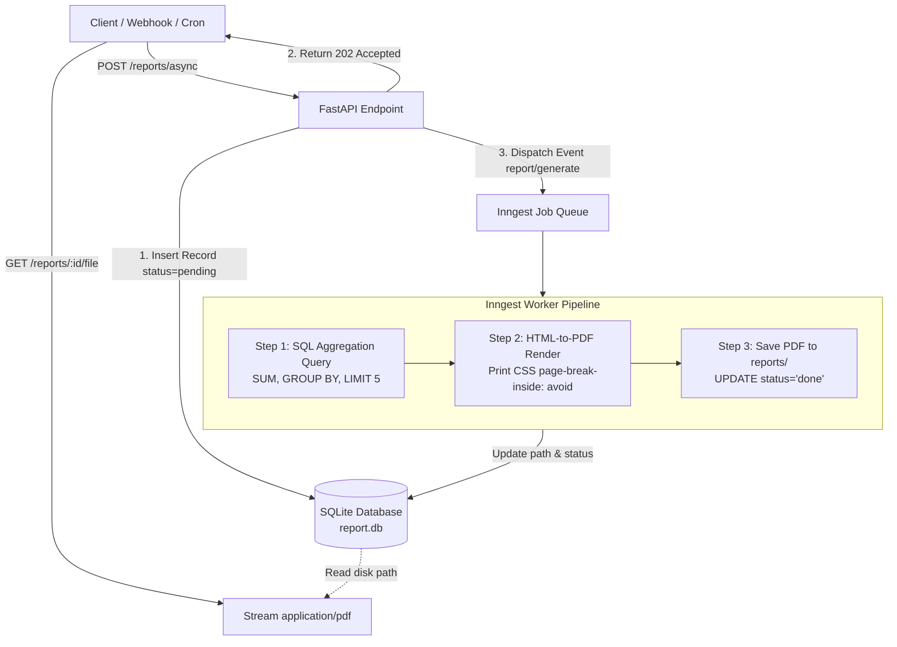

# BE-08: PDF Report Generator Pipeline

**Track:** Backend AI Engineering · **Week:** 7 · **Workload:** 6 hours · **Phase:** Build+  
**Stack:** FastAPI · SQLite · xhtml2pdf / ReportLab · Inngest · Pydantic · Python 3.12

---

## Executive Overview

Generating reports is the quintessential background job in modern SaaS engineering. Every enterprise platform ships it. This project implements a production-grade asynchronous PDF report generation pipeline designed around the **Store and Link** pattern and the **A7 Background Job Architecture**.

### Key Architectural Tenets
1. **Never pass 20 MB of file bytes in JSON**: Generation returns a lightweight metadata descriptor and a dedicated file download link (`POST /reports` → `201 Created` + `{"file": "/reports/:id/file"}`).
2. **Solve the Page-Break Trap**: Pure print CSS (`@page`, `tr { page-break-inside: avoid; }`, `thead { display: table-header-group; }`) guarantees that multi-page tables are never sliced across rows and headers repeat across pages.
3. **Database-Driven Aggregation**: Pushes heavy sums, date truncation, and groupings to the SQLite database engine rather than loading raw records into Python memory.
4. **Idempotency (Ask Twice, Get One)**: Prevents accidental duplicate generation on rapid clicks or network retries by checking existing reports generated for today. Supports forced regeneration via `{"force": true}`.
5. **Asynchronous Background Processing (A7 Pattern)**: Dispatches generation jobs to Inngest with `202 Accepted`, allowing clients to poll status from `pending` to `done`. Scheduled reports run automatically via Monday 08:00 AM UTC cron.

---

## Architecture Diagram



---

## Pipeline Stages & Implementations

### Stage 0: Repo Setup
- FastAPI application scaffolding with health check endpoint:
  ```bash
  curl http://localhost:8000/health
  # {"status": "ok"}
  ```

### Stage 1: Seed Script (`seed.py`)
- Populates `report.db` with 200 orders spread realistically across the last 30 days.
- **Idempotency Guarantee**: Deletes all rows prior to insertion, ensuring that executing `python seed.py` multiple times leaves exactly 200 clean rows.
- Schema:
  ```sql
  CREATE TABLE orders (
      id INTEGER PRIMARY KEY AUTOINCREMENT,
      customer TEXT NOT NULL,
      product TEXT NOT NULL,
      amount REAL NOT NULL,
      created_at TEXT NOT NULL
  );

  CREATE TABLE reports (
      id INTEGER PRIMARY KEY AUTOINCREMENT,
      path TEXT NOT NULL,
      status TEXT NOT NULL DEFAULT 'done',
      created_at TEXT NOT NULL
  );
  ```

### Stage 2: SQL Aggregation Query (`report_data.py`)
Executes four dedicated SQL aggregation queries:
1. **Summary Totals**:
   ```sql
   SELECT COUNT(*) as total_orders, COALESCE(SUM(amount), 0.0) as total_revenue FROM orders
   ```
2. **Top 5 Products by Revenue**:
   ```sql
   SELECT product, COUNT(*) as units_sold, SUM(amount) as revenue
   FROM orders
   GROUP BY product
   ORDER BY revenue DESC
   LIMIT 5
   ```
3. **Daily Breakdown (Last 7 Days)**:
   ```sql
   SELECT substr(created_at, 1, 10) as order_date, COUNT(*) as order_count, SUM(amount) as daily_revenue
   FROM orders
   GROUP BY order_date
   ORDER BY order_date DESC
   LIMIT 7
   ```
4. **All Orders Table**:
   ```sql
   SELECT id, customer, product, amount, created_at FROM orders ORDER BY created_at DESC
   ```

### Stage 3: HTML-to-PDF Template & The Page-Break Trap (`renderer.py`)
The classic PDF rendering failure occurs when table rows are split horizontally right across a line of text at a page boundary.

#### The Fix:
```css
@page {
    size: A4;
    margin: 14mm 12mm 14mm 12mm;
    @bottom-right {
        content: "Page " counter(page) " of " counter(pages);
        font-size: 8pt;
        color: #64748b;
    }
}

/* 1. Prevent table rows from splitting across page cuts */
tr {
    page-break-inside: avoid !important;
    break-inside: avoid !important;
}

/* 2. Repeat table headers automatically on every new page */
thead {
    display: table-header-group;
}
```
Generates a clean 7-page PDF report with complete typography, status badges, KPI cards, and repeating table headers.

### Stage 4: Store and Serve by Link (`main.py`)
- Generating a report stores the artifact under `reports/sales-report-<id>-<date>.pdf`.
- `POST /reports` returns HTTP `201 Created` with metadata:
  ```json
  {
    "id": 1,
    "status": "done",
    "file": "/reports/1/file",
    "created_at": "2026-11-19 15:34:53"
  }
  ```
- `GET /reports/1/file` streams binary PDF data (`application/pdf`) with `Content-Disposition: inline; filename="sales-report-1-2026-11-19.pdf"`.
- JSON endpoints **never** serialize file bytes.

### Stage 5: Idempotency (Ask Twice, Get One)
- When a client sends a second `POST /reports` on the same date without `force: true`:
  - Returns HTTP `200 OK` (instead of `201 Created`).
  - Returns the existing report ID and file link without burning CPU or disk rendering a duplicate.
- Forced regeneration:
  ```bash
  curl -X POST http://localhost:8000/reports \
    -H "Content-Type: application/json" \
    -d '{"force": true}'
  # Returns 201 Created with fresh report ID
  ```

### Stage 6: Inngest Background Job & Cron Stretch (`POST /reports/async`)
- Returns HTTP `202 Accepted` immediately with `status: "pending"`.
- Triggers Inngest background event `report/generate`.
- Multi-step durable execution:
  - Step 1: `query-sql-data`
  - Step 2: `render-html-to-pdf`
  - Step 3: `store-artifact-and-finalize`
- **Weekly Cron (`0 8 * * 1`)**: Automatically triggers executive report generation every Monday at 08:00 AM UTC.

---

## Stage 7: The AI Rematch (AI vs Me)

We prompted an AI to generate the feature from scratch in a fresh quarantined folder (`ai-version/`) and benchmarked the architecture side-by-side using `ai-version/benchmark_diff.py`:

| Dimension | AI Naive Implementation | Our Production Pipeline | Production Impact |
| :--- | :--- | :--- | :--- |
| **Response Size** | 13,631 bytes (Base64 in JSON) | **147 bytes** (Store & Link) | **98.9% API payload reduction** |
| **Database Logic** | `SELECT *` into memory + Python loops | **SQL Engine Aggregation** (`SUM`, `GROUP BY`) | Prevents OOM crashes on large tables |
| **Page-Break CSS** | Missing (Sliced rows across pages) | `tr { page-break-inside: avoid; }` | Clean professional multi-page document |
| **Header Repeating** | Missing (Orphaned headers) | `thead { display: table-header-group; }` | Repeated headers on all 7 pages |
| **Idempotency** | None (Duplicates generated every call) | **Date-based lookup + `{force: true}`** | Zero duplicate disk/CPU waste |
| **Job Pattern** | Blocking synchronous execution | **Async `202 Accepted` + Inngest Job Queue** | Zero HTTP timeout risk on heavy reports |

---

## Running & Verifying

### 1. Seed Database
```bash
python seed.py
# Seeded report.db: 200 orders present in table 'orders'.
```

### 2. Run Test Suite
```bash
python test_api.py
```
**Test Results:**
```text
=== 1. Seeding test database ===
Seeded 200 orders.

=== 2. Testing GET /health ===
✓ GET /health: 200 OK

=== 3. Testing POST /reports (Stage 4 Checkpoint) ===
✓ Generated Report #7 (201 Created)

=== 4. Testing GET /reports/:id (Metadata) ===
✓ Metadata verified. File exists on disk: reports/sales-report-7-2026-11-19.pdf

=== 5. Testing GET /reports/:id/file (Download PDF) ===
✓ Downloaded PDF. Size: 38,904 bytes. Starts with %PDF: True

=== 6. Testing 404 for unknown report ID ===
✓ GET /reports/999999 returned 404 Not Found

=== 7. Testing Stage 5 Idempotency (Ask twice, get one) ===
✓ Second request returned existing report ID (200 OK) without generating duplicate file!

=== 8. Testing Stage 5 Force Bypass ({'force': True}) ===
✓ Forced request generated fresh Report #8 (201 Created)

=== 9. Testing Stretch Async Background Job (POST /reports/async) ===
✓ Async report #9 status polled: done
✓ Async report #9 generated PDF downloaded (38,904 bytes)

=== ALL TESTS PASSED SUCCESSFULLY! ===
```

### 3. Run AI vs Me Benchmark
```bash
python ai-version/benchmark_diff.py
```

### 4. Start Server
```bash
uvicorn main:app --reload --port 8000
```
