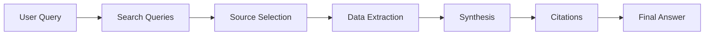

# Research & Verification: Trust, But Check

**Track:** General AI Fluency · **Type:** Event / Masterclass · **Date:** Aug 20, 2026, 12:00 PM  
**Host:** Eldin (Director of AI, Prompt Engineering) · **Duration:** 90 minutes  
**Recording:** [YouTube Live Session](https://www.youtube.com/watch?v=0Q9UJU77KzY)  
**Curriculum References:**
- [SIFT (The Four Moves) by Mike Caulfield](https://hapgood.us/2019/06/19/sift-the-four-moves/)
- [Wikipedia: Signs of AI Writing](https://en.wikipedia.org/wiki/Wikipedia:Signs_of_AI_writing)

---

## 1. Executive Summary: The Core Question — "Is It True?"

> *"By now you're producing fast, which means you're already shipping unverified work, and AI sounds most confident exactly when you can least afford to trust it. In FlyRank's model this session is the senior-editor step, the check before a client sees anything."*

As AI developers and operators, rapid generation is dangerous without rigorous verification. Large language models use the exact same calm, fluent, authoritative tone whether they are stating undeniable truth, misinterpreting context, or completely hallucinating facts. **Fluency is not accuracy, and confidence is not a receipt.**

The purpose of this session is to establish the senior-editor mindset: pulling load-bearing claims out of source material, auditing AI-generated assertions against independent empirical evidence, managing verification taxonomies, and recognizing the structural tells of AI-generated content.

---

## 2. SIFT: The Four Moves (Mike Caulfield & Lateral Reading)

Developed by Mike Caulfield based on Stanford History Education Group (SHEG / Sam Wineburg) research comparing professional fact-checkers to students and academics, **SIFT** is the fastest, most effective verification routine available.

### The Four Moves (S-I-F-T)

1. **S — Stop**:
   - When encountering a claim, statistic, or shocking insight—especially when it evokes emotional validation or urgency—**pause**.
   - Check if you know the source and its reputation before embedding it into your work or building on it.
2. **I — Investigate the Source**:
   - Assess *who* produced or sponsored the content before investing time in *what* it claims.
   - Practice **Lateral Reading**: Leave the page immediately. Open fresh browser tabs to discover what external, independent sources say *about* the publisher or author.
   - *Why vertical (deep) reading fails:* Content farms and synthetic sites excel at surface polish, fake "About Us" bios, and visual credibility.
3. **F — Find Better Coverage**:
   - If the original source is obscure, biased, or sensationalized, look for trusted consensus coverage across established industry or academic publications.
   - True claims will almost always have broader, higher-quality reporting elsewhere.
4. **T — Trace Claims, Quotes, and Media to the Original Context**:
   - Follow quotes, metrics, images, and video back to their primary source (original research paper, unedited dataset, court transcript, or SEC filing).
   - In secondary reporting and AI summaries, context is stripped and nuances are frequently inverted.

---

## 3. The AI Research Pipeline & How Citations Fail

Modern AI research is an **agentic pipeline**, not a single act of recall:

### Failures Can Occur at Every Transition:
- **Query Formulation:** The model translates your intent into narrow or biased search keywords.
- **Source Selection:** Search APIs rank SEO-optimized listicles above authoritative primary papers.
- **Extraction:** Table structures, numeric footnotes, or negation clauses get dropped.
- **Synthesis:** The model blends contradictory sources into a single false narrative.
- **Citation Attribution:** Links are attached to sentences that the source does not actually substantiate.

### Empirical Failure Rates
- **Tow Center Study (Columbia University, 2025):** 1,600 search queries across 8 major AI search engines returned incorrect answers **>60% of the time**.
- **BBC & European Broadcasting Union (EBU) Study:** 3,000+ AI-generated answers evaluated by journalists found **nearly 50% had significant errors**, and 1 in 5 contained severe factual inaccuracies.

### The Six Ways AI Citations Fail:
1. **Nonexistent Source:** Hallucinated URLs, invented authors, or dead DOIs.
2. **Metadata Mismatch:** Real source, but wrong publication date, author, or organization.
3. **Unsubstantiated Claim:** The source exists, but nowhere does it say what the model asserts.
4. **Overstated / Weakened Support:** The paper says *"may correlate under lab conditions"*; the model writes *"proves conclusively in all settings"*.
5. **Outdated Context:** Accurate at original publication, but rendered obsolete by newer data.
6. **Secondary / Circular Echoes:** Sources circularly quoting unverified blog posts or AI summaries.

---

## 4. Reading for Load-Bearing Claims & Claim Atomization

### The Three Paragraph Layers
Before auditing, classify each sentence into its operational layer:
1. **Factual Claim:** What objectively happened or was measured? *(e.g., "Organic search referrals dropped 35% in Q3")*
2. **Interpretation:** What does the author believe it means? *(e.g., "Generative AI is cannibalizing search volume")*
3. **Recommendation:** What action are they asking you to take? *(e.g., "Pivot marketing budget to social channels")*

### Load-Bearing Claims
A **load-bearing claim** is an assertion upon which the entire argument rests. If that single factual claim is proven false, outdated, or unsubstantiated, the entire conclusion collapses.

### Claim Atomization
Compound sentences must be decomposed into atomic, independently checkable facts:
- *Compound Sentence:* "FlyRank increased organic traffic by 60% for European SaaS clients in 2025."
- *Atomic Statements:*
  1. FlyRank performed the optimization work.
  2. The clients were business-to-business SaaS companies.
  3. The clients operated within Europe.
  4. Organic traffic increased.
  5. The magnitude of the increase was exactly 60%.
  6. The observed timeframe was calendar year 2025.

### The Three Audit Lists
Every source analysis must compile:
- **Claims:** What the text asserts as empirical fact.
- **Assumptions:** What unstated premises must be true for the argument to hold.
- **Open Questions:** What critical variables did the source omit?

---

## 5. Practical Verification Workflow & The 7 Claim Statuses

### The Golden Rule
> **Never ask the model to confirm itself.**
> Asking *"Are you sure?"* or prompting another model trained on the same common-crawl data does not produce evidence. It produces echo chambers. Independent primary evidence is the only receipt.

### The 7 Claim Statuses for Professional Audits

| Status | Definition | Prescribed Editorial Action |
| :--- | :--- | :--- |
| **Verified** | Independent primary evidence confirms the claim verbatim as written. | Keep claim; document primary source URL and exact supporting excerpt. |
| **Unsupported** | Insufficient evidence found; claim may be true, but evidence is unearned. | Seek primary source; if none exists, remove from client deliverable. |
| **Outdated** | Factually accurate when published, but superseded by newer events. | Update with current metrics or revise temporal context. |
| **Vague** | Loose qualitative descriptors (*"leading"*, *"rapidly"*, *"significant"*) that evade measurement. | Rewrite with concrete numbers, benchmarks, or explicit dates. |
| **Incorrect** | Contradicted by authoritative empirical evidence. | Correct the error or strike the claim. |
| **Risky** | Plausible or defensible, but carries severe legal, financial, or reputational downside if false. | Escalate for senior domain expert / legal review. |
| **Remove** | Low-value, unverified, or disproportionately dangerous assertion. | Delete without burning further engineering hours. |

*Auditing Principle:* **Unsupported does not mean false; verified does not permanently mean true.** Audits must record: exact claim, status, primary source URL, publication date, check date, and verbatim excerpt.

---

## 6. Spotting AI-Generated Content (Wikipedia "Signs of AI Writing")

Wikipedia's *WikiProject AI Cleanup* maintains **WP:AISIGNS**, the web's most rigorous taxonomy of LLM writing tells.

### Major Warning Signs

1. **Content & Tone Tells:**
   - *Superficial Neutrality & False Balance:* Giving equal weight to fringe claims or settled science.
   - *Generic Platitats & Fluff:* Phrases that sound profound while conveying zero information (*"stands at the intersection of tradition and progress"*).
   - *False Ranges:* Inventing artificial spectrums (*"from intimate workshops to global movements"*).
2. **Grammar & Lexicon Tells:**
   - *The Rule of Three:* Compulsive grouping in triads (*"innovative, resilient, and transformative"*).
   - *Negative Parallelism:* Repetitive antithesis (*"It is not merely a tool; it is a catalyst"*).
   - *The AI Lexicon:* Overuse of `delve`, `tapestry`, `testament`, `beacon`, `landscape`, `interplay`, `foster`, `underscore`, `pivotal`, `crucial`, `vibrant`, `nuanced`.
   - *Copulative Avoidance:* Replacing simple verbs (*"is"*, *"was"*) with inflated substitutes (*"serves as"*, *"stands as"*).
3. **Structural Tells:**
   - *Over-Formatting:* Incessant bold text in every sentence, excessive nested bullet lists.
   - *Formulaic Essay Arc:* Introductory declarations (*"This section explores..."*) followed by compulsive summary conclusions (*"In conclusion, [Subject] remains a testament..."*).
4. **Citation & Evidence Tells:**
   - Hallucinated authors or journals with plausible-sounding names.
   - Citation misalignment where the source exists but discusses a different topic.

### The Professional Move
> **Do not play gotcha detective.** The professional move is never to accuse someone of using AI (detectors have massive false-positive rates and unfairly penalize non-native English speakers). The professional move is to **treat the content as unverified draft material and audit the load-bearing claims.**

---

## 7. Five Takeaways for Engineering Practice

1. **AI research answers are multi-step pipelines**, not single acts of recall.
2. **Failures compound at every step** of search, extraction, synthesis, and citation.
3. **Verify atomic claims**, never broad paragraphs.
4. **A citation is only a lead to check**, never proof that the claim is true.
5. **Treat AI output as an unverified draft** before any client or stakeholder sees it.
