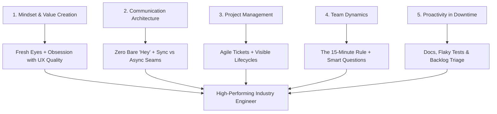

# From Internship to Industry: Navigating Tools, Teams, and Career Ownership

**Track:** General AI Fluency · **Type:** Event / Masterclass · **Session Date:** Aug 27, 2026, 11:00 AM  
**Speaker:** Andjela Buzuk (Delivery Lead & Project Manager, FlyRank) · **Duration:** 90 Minutes  
**Format:** Live Interactive Masterclass · **Recording:** [YouTube Live Session](https://www.youtube.com/watch?v=h5ERm7oFnTg)  
**Direct Event URL:** [https://internship.flyrank.ai/intern/events/CUSTOM-MSHEQM4H-48BC4DDC](https://internship.flyrank.ai/intern/events/CUSTOM-MSHEQM4H-48BC4DDC)

---

## 1. Executive Summary: The Soft-Skills Engine Behind Technical Excellence

> *"While the curriculum has covered deep technical skills, this session focuses on soft skills, workplace norms, and execution mindset to ensure our graduates successfully transition into full-time engineering environments."*

Engineering competence is the price of admission; workplace intelligence and communication architecture determine career velocity. Junior engineers rarely fail because of syntax errors; they fail when they:
- Communicate invisibly or ambiguously in remote teams.
- Spin their wheels silently for days instead of unblocking themselves.
- Treat tickets as isolated code chores rather than customer value delivery.
- Freeze into passivity the moment their assigned tasks run out.

This masterclass deconstructs the concrete protocols top engineering organizations expect from day one.

---

## 2. The 5 Pillars of Career Ownership

---

## 3. Pillar-by-Pillar Breakdown

### Pillar 1: Mindset & Value Creation
- **The Junior Superpower ("Fresh Eyes"):** You are the only person on the team who has not been blinded by legacy architecture decisions or "how we've always done it." Respectful, constructive questioning of convoluted onboarding steps or undocumented APIs is an enormous asset.
- **Product Empathy:** A pull request is not done when the code compiles; it is done when the user experience is delightful, resilient, and verified.

### Pillar 2: Communication Architecture
- **Sync (Slack / Teams) vs. Async (Gmail / Notion / RFCs):**
  - *Synchronous Chat:* Urgent production blockers, brief coordination, quick pairing.
  - *Asynchronous Paper Trails:* Architecture decisions, schema agreements, design reviews, post-mortems. If a decision matters 6 months from now, it belongs in a permanent document, not ephemeral Slack threads.
- **The "No-Hello" Rule:** Never send a bare *"Hey"* or *"Hi Jezreal"*. Send the greeting, context, and question in a single message so colleagues can answer asynchronously.
- **Active Listening in the First 90 Days:** 80% of success early on is listening, taking structured notes, and validating requirements before touching code.

### Pillar 3: Project Management Methodologies
- **Agile Ticket Lifecycles:**
  $$\text{Backlog} \longrightarrow \text{In Progress} \longrightarrow \text{In Review (PR)} \longrightarrow \text{QA / Staging} \longrightarrow \text{Done}$$
- **The Daily Standup Protocol:** Keep it under 60 seconds:
  1. *What I finished yesterday* (with links to PRs/tickets).
  2. *What I am committing to today*.
  3. *Blockers* (specific dependencies or technical impediments).

### Pillar 4: Team Dynamics & The 15-Minute Rule
- **The 15-Minute Rule:**
  - When stuck on a bug or environment failure, spend **15 focused minutes** debugging independently: read logs, check docs, isolate test cases.
  - If still stuck after 15 minutes, **you must ask for help**. Sitting silent for 2 days burning sprint time is unprofessional.
- **The "Smart Question" Template:**
  1. **Goal:** *"I am trying to run the Inngest local dev server connected to FastAPI."*
  2. **Attempt:** *"I started the background worker with `-u http://127.0.0.1:8000/api/inngest`."*
  3. **Observed Error:** *"The CLI throws `404 Not Found` on the health check probe."*
  4. **Hypothesis:** *"It looks like the Inngest router prefix is mounted at `/api` rather than `/`."*

### Pillar 5: Proactivity & Managing Downtime
- **The Cardinal Rule:** Never sit idle waiting for a manager to notice you have no tasks.
- **Downtime Action Plan:**
  1. Improve developer onboarding docs (`README.md`, setup scripts, common bug gotchas).
  2. Fix flaky tests or add test coverage to edge cases.
  3. Review senior engineers' closed pull requests to learn team idioms and patterns.
  4. Pick up low-priority "good first issue" bugs from the sprint backlog.

---

## 4. Verification & Artifact Record

- **Session Recording:** [YouTube Live Session](https://www.youtube.com/watch?v=h5ERm7oFnTg)
- **Portal Status:** Verified and documented on [FlyRank Portal](https://internship.flyrank.ai/intern/events/CUSTOM-MSHEQM4H-48BC4DDC)
- **Submission Deliverable:** `Week 7/submissions/From_Internship_to_Industry_Jezreal_Momoh.pdf`
