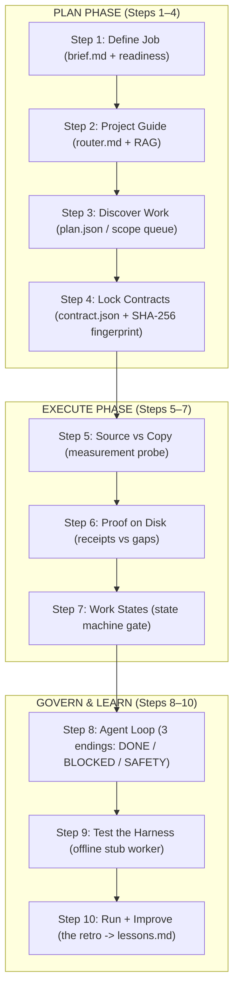

# Harness Engineering Playbook: From Chatbots to Agents

**Track:** Backend AI Engineering · **Type:** Workshop & Guided Build · **When:** Week 8  
**Duration:** 90 Minutes · **Format:** Pre-recorded Build Video (25 min mastercut + 10 chapters)  
**Playbook Repository:** [https://github.com/flyrank-bih/harness-engineering-playbook](https://github.com/flyrank-bih/harness-engineering-playbook) (MIT License)  
**Session Video:** [https://www.youtube.com/watch?v=xkeD94i-zi8](https://www.youtube.com/watch?v=xkeD94i-zi8)  
**Portal Event URL:** [https://internship.flyrank.ai/intern/events/CUSTOM-MQYEKU0J-15E5EF9A](https://internship.flyrank.ai/intern/events/CUSTOM-MQYEKU0J-15E5EF9A)

---

## 1. Executive Summary & The Core Philosophy

> *"A chat talks, an agent does work, but a harness is the system around it."*

In modern production systems, an autonomous agent cannot be deployed as a raw LLM connected to a prompt. Doing so creates brittle, non-deterministic behaviors, token-burning loops, and silent failure cascades.

$$\text{Production Agent} = \text{Model} + \text{Harness}$$

The **Harness** provides the operational scaffolding:
1. **Bounded Job Definition:** A crisp brief with explicit truth and done definitions.
2. **File-Based RAG:** Dynamic markdown routers instead of monolithic system prompts.
3. **Plan / Execute Separation:** Scope discovery happens prior to and separated from mutation.
4. **Frozen Contracts & Fingerprints:** Cryptographic sealing preventing agents from lowering standards.
5. **Deterministic Source vs. Copy Loop:** Measuring actual outputs against frozen contracts.
6. **Hard Proofs on Disk:** Ephemeral claims rejected; only persistent receipts accepted.
7. **Three-Terminal State Machine:** Clean endings (`DONE`, `BLOCKED`, `SAFETY_LIMIT`).
8. **Offline Testability:** Testing the harness itself with stub workers before executing real LLMs.

---

## 2. The 10-Step Harness Architecture



### Detailed Step Walkthrough

#### Step 1 — Define the Job
- **Brief (`brief.md`):** Documents the job description, the single source of truth, and the exact definition of done.
- **Readiness Check:** A pre-flight environment check that refuses to execute if prerequisites (dependencies, ports, base commits) are invalid.

#### Step 2 — Project Guide (RAG Without a Vector DB)
- **The Router (`guides/router.md`):** Instead of stuffing 50 pages of instructions into the model's context window, provide a clean index table. The agent reads the router to navigate directly to targeted operational docs.
- **"Wrote It Down" vs. "Proved It":** The agent saying *"I verified the endpoint"* is zero evidence. Only a cryptographic receipt written to disk constitutes proof.

#### Step 3 — Discover Work (Plan and Execute Stay Apart)
- Discovers the work queue (routes, content records, schemas) and writes `plan.json` to disk.
- **Rule:** The Plan phase never executes code; the Execute phase never edits the plan scope.

#### Step 4 — Lock Contracts
- Establishes a frozen schema contract (`contracts/post_tasks.contract.json`).
- Generates a SHA-256 fingerprint (`contracts/post_tasks.contract.fingerprint`).
- If an agent attempts to edit the contract to make a failing test pass, the runner detects the hash mismatch and halts immediately.

#### Step 5 — Source vs. Copy (Measurement Probe)
- Invokes the endpoint via a deterministic measurement probe (`probe.py`).
- Captures status code, response headers, JSON body, latency, and response content SHA-256 hash.

#### Step 6 — Proof on Disk
- Compares measured result against the contract across 4 levels:
  1. HTTP status code match.
  2. Latency bound (< 500ms).
  3. JSON structure & required fields.
  4. Business invariants (ID prefixes, enum values).
- If compliant: writes `proofs/receipt.json`.
- If non-compliant: writes `proofs/gaps.json`. Only a new measurement can clear gaps.

#### Step 7 — Work States
- Work prompt acts as a state machine reading `state.json` on disk:
  `INITIALIZING` $\rightarrow$ `RUNNING` $\rightarrow$ `DONE` / `BLOCKED` / `SAFETY_LIMIT`.
- Refuses premature completion without an accompanying valid receipt.

#### Step 8 — The Agent Loop & The Three Endings
- `DONE` (Exit 0): All invariants met, proof sealed.
- `BLOCKED` (Exit 2): Contract modified, schema mismatch, or broken precondition. Clean handoff.
- `SAFETY_LIMIT` (Exit 3): Step ceiling (5 iterations) reached without convergence. Prevents runaway token billing.

#### Step 9 — Test the Harness
- Employs an offline stub worker (`stub_worker.py`) to test the guardrails themselves.
- Proves the harness blocks tampered contracts, catches gaps, and enforces safety limits without requiring external API calls.

#### Step 10 — Run + Improve (The Retrospective)
- Captures hard-won operational discoveries and moves them into `guides/lessons.md`.
- Never rewrites the original baseline; compounds organizational knowledge over time.

---

## 3. The Worked Hands-On Exercise

**Exercise Prompt:**
> *"Take one endpoint from the API you built earlier in this internship and build a small harness around it — brief (job, truth, done), a frozen contract with a fingerprint, a normal script that writes a fresh result file, a runner with three endings (done, blocked, safety limit) tested with a stub worker, and one hard-won fact moved into the right guide. Not your whole project — one endpoint."*

### Implementation Structure
The complete harness was built in [`flyrank-backend-ai-engineering/BE-W8-harness-engineering/`](file:///home/jmomoh/FlyRank%20AI/flyrank-backend-ai-engineering/BE-W8-harness-engineering/):

```
BE-W8-harness-engineering/
├── brief.md                          # Step 1: Job, truth, and done definitions
├── contracts/
│   ├── post_tasks.contract.json      # Step 4: Frozen schema & invariant contract
│   └── post_tasks.contract.fingerprint # SHA-256 seal (8a798523ab22216e...)
├── guides/
│   ├── router.md                     # Step 2: Markdown router for agent navigation
│   └── lessons.md                    # Step 10: Hard-won operational facts
├── proofs/
│   ├── result.json                   # Step 5: Fresh probe measurement output
│   ├── receipt.json                  # Step 6: Cryptographically sealed proof
│   └── gaps.json                     # Step 6: Recorded invariant violations
├── probe.py                          # Step 5: Fast deterministic measurement probe
├── runner.py                         # Step 7/8: 3-ending state machine engine
├── stub_worker.py                    # Step 9: Offline stub worker for harness tests
├── test_harness.py                   # Step 9: 4-case automated pytest verification
└── state.json                        # Step 7: Persistent disk state machine
```

### Verification & Pytest Output
The automated test suite (`test_harness.py`) passes 100% offline:

```
============================= test session starts ==============================
rootdir: /home/jmomoh/FlyRank AI/flyrank-backend-ai-engineering/BE-W8-harness-engineering
plugins: anyio-4.15.1
collected 4 items

test_harness.py::test_harness_ending_done PASSED                         [ 25%]
test_harness.py::test_harness_ending_blocked_on_gap PASSED               [ 50%]
test_harness.py::test_harness_ending_blocked_on_fingerprint_tamper PASSED [ 75%]
test_harness.py::test_harness_ending_safety_limit PASSED                 [100%]

============================== 4 passed in 1.85s ===============================
```
